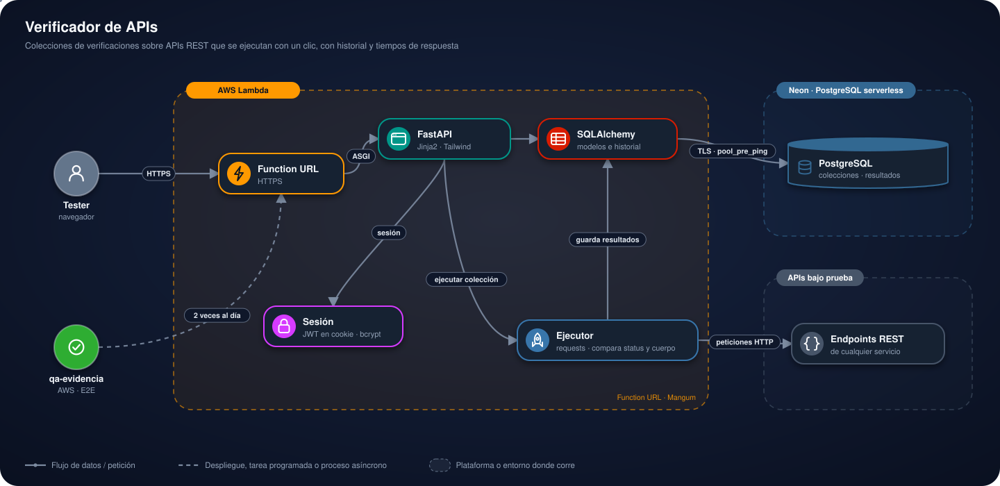

# Verificador de APIs

<p>
  <a href="https://eofvlnitsiuodup4eywdcenxwu0adgbz.lambda-url.us-east-1.on.aws/"></a>
  <a href="https://frontend-nine-topaz-99.vercel.app"></a>
  <a href="https://d4i3vsgw7xwmh.cloudfront.net"></a>
</p>


> 📘 **[Manual de usuario](docs/MANUAL.md)**: cómo usar cada pantalla, paso a paso y con imágenes.

## Contenido

1. [Presentación](#1-presentación)
2. [Funcionalidades](#2-funcionalidades)
3. [Arquitectura](#3-arquitectura)
4. [Estructura del proyecto](#4-estructura-del-proyecto)
5. [Instalación para pruebas](#5-instalación-para-pruebas)
6. [Autor y licencia](#6-autor-y-licencia)

---

## 1. Presentación

Herramienta de automatización de pruebas de API: define colecciones de verificaciones (método,
ruta, encabezados, cuerpo, código de estado y contenido esperados) y ejecútalas con un clic, con
historial de resultados y tiempos de respuesta. Una versión propia y simplificada de lo que hace
Postman/Newman.

- **Qué hace:** anotas qué petición hacer (por ejemplo `GET /usuarios/1`) y qué esperas recibir
  (código 200, cierto texto en la respuesta); luego ejecutas la colección y ves qué pasó, qué falló
  y cuánto tardó cada una.
- **Para qué sirve:** detectar rápido si un cambio rompió algo y guardar un historial de
  resultados como evidencia de pruebas.
- **Cómo probarlo:** entra a la [demo](https://eofvlnitsiuodup4eywdcenxwu0adgbz.lambda-url.us-east-1.on.aws/),
  crea una cuenta, arma una colección y ejecútala.

## 2. Funcionalidades

- Registro e ingreso con verificación en dos pasos obligatoria (app autenticadora o código por correo).
- Colecciones de pruebas HTTP con método, ruta, encabezados, cuerpo y aserciones.
- Ejecución de la colección completa con un clic, con tiempos por petición.
- Historial de ejecuciones con el detalle de cada prueba.
- Adaptable a celular, tablet y computador, tema claro y oscuro, e instalable como aplicación.

## 3. Arquitectura

<p align="center">
  
</p>

- Las páginas usan Jinja2 + Tailwind.
- El **ejecutor** recorre la colección, llama a cada endpoint y compara el código de estado y el
  contenido con lo esperado.
- **SQLAlchemy** guarda colecciones, pruebas y resultados.
- Se publica solo desde GitHub en cada cambio a `main`, después de pasar las pruebas automáticas.

## 4. Estructura del proyecto

```
app/
├── main.py         Arranque de FastAPI
├── models.py       Colección, prueba, ejecución y resultado
├── ejecutor.py     Corre las pruebas de una colección
├── routers/        Páginas por sección
├── templates/      Jinja2 + Tailwind, tema claro/oscuro
└── static/         Estilos e íconos
tests/              Pruebas automáticas (pytest)
docs/               Manual de usuario y diagramas
```

## 5. Instalación para pruebas

Requisitos: Python 3.12 y una base PostgreSQL propia.

```bash
python -m venv .venv
.venv\Scripts\Activate.ps1        # Windows (en Linux o macOS: source .venv/bin/activate)
pip install -r requirements.txt
cp .env.example .env              # completa las variables que indica la plantilla
uvicorn app.main:app --reload --port 8300
```

Abre `http://127.0.0.1:8300` y crea tu cuenta. Las pruebas automáticas (`python -m pytest -q tests`)
usan una base temporal y no envían correos. Nunca subas tu `.env` al repositorio.

## 6. Autor y licencia

**Luis F. A.** · [GitHub](https://github.com/lariasca1994) · [LinkedIn](https://linkedin.com/in/lfac1)

Contacto: Telegram [@lfac6](https://t.me/lfac6) · WhatsApp [@carraian160](https://wa.me/carraian160) ·
[ariascluisf@hotmail.com](mailto:ariascluisf@hotmail.com)

Licencia: MIT.
