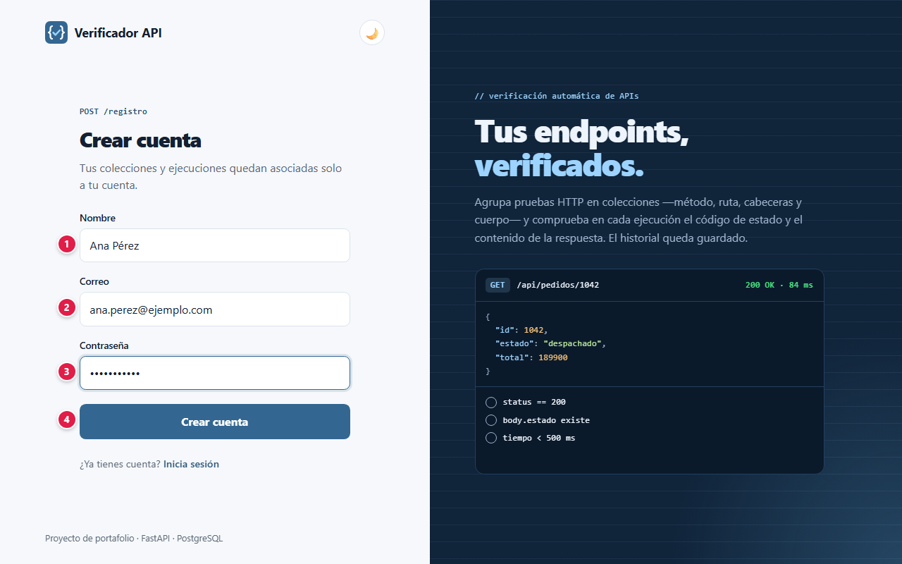
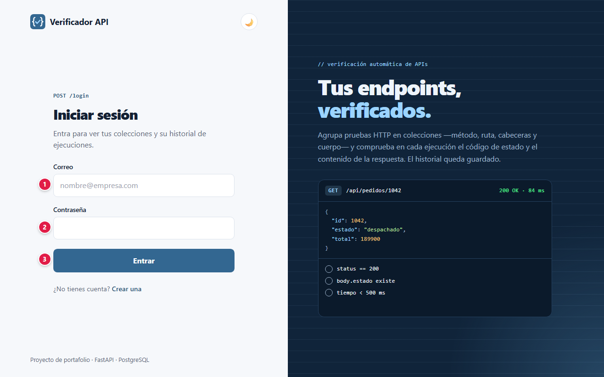
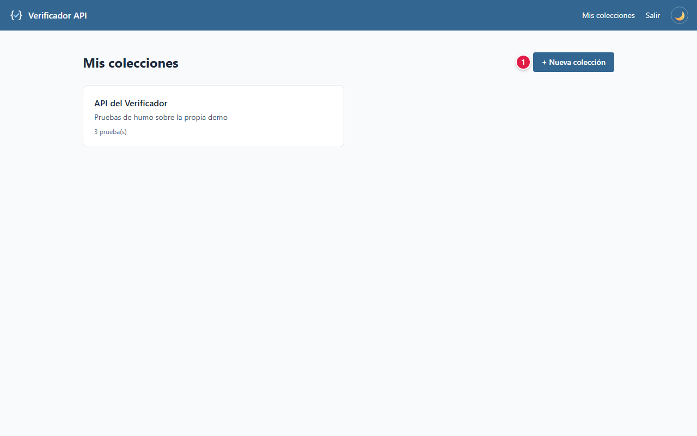
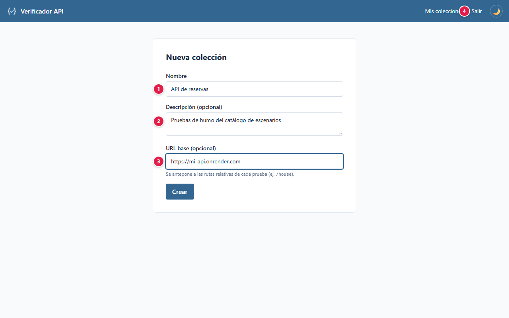
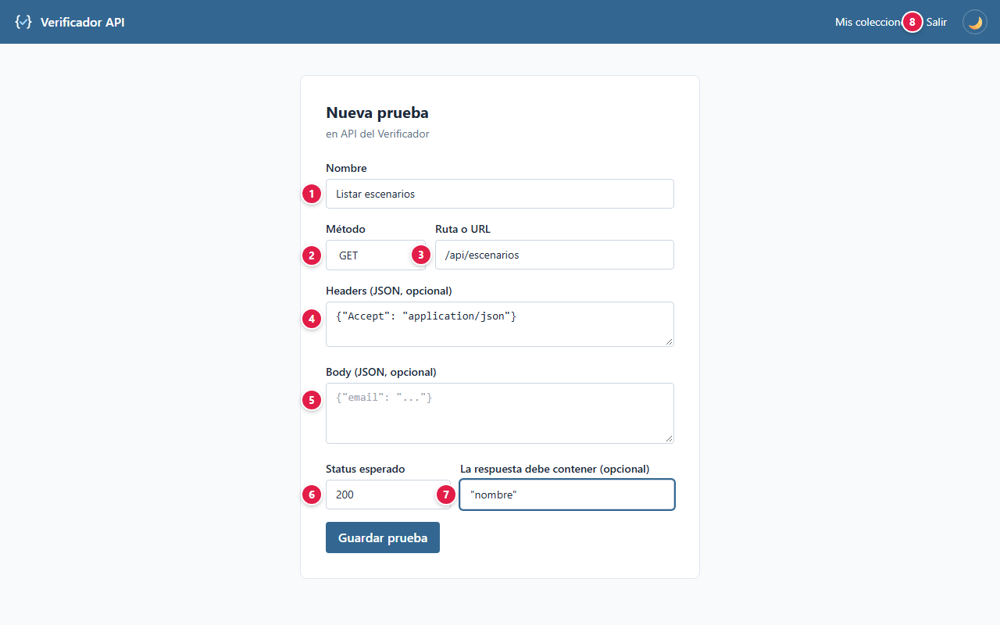
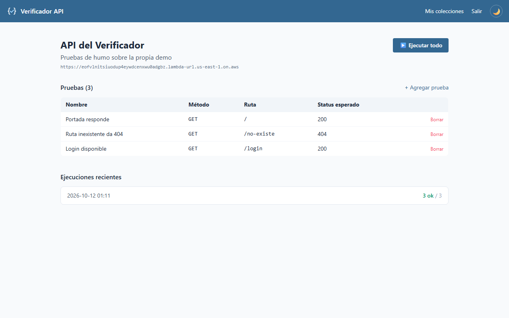
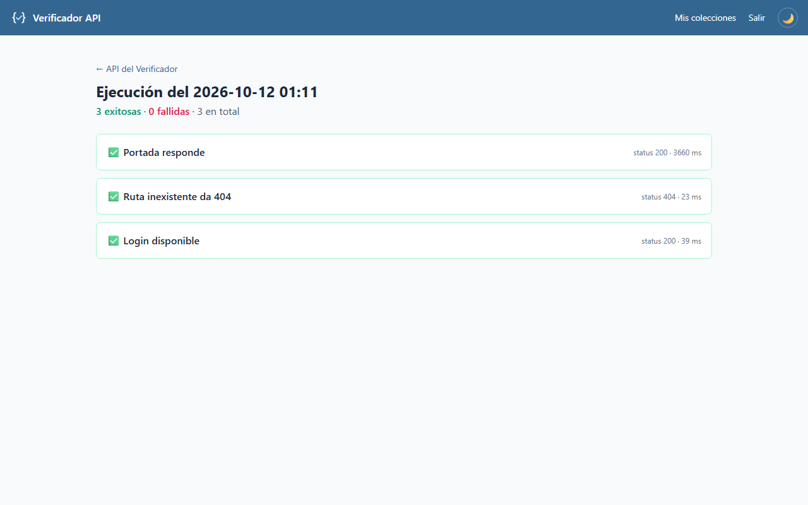

# 📘 Manual de usuario · Verificador API

Guía para usar la plataforma paso a paso: qué significa cada campo, qué datos se ingresan y qué
protege la plataforma. Para la parte técnica vuelve al [README](../README.md).

**Demo:** [Verificador API (AWS Lambda)](https://eofvlnitsiuodup4eywdcenxwu0adgbz.lambda-url.us-east-1.on.aws/)

## Contenido

1. [Proyecto: objetivos y alcances](#1-proyecto-objetivos-y-alcances)
2. [Glosario](#2-glosario)
3. [Plataformas, base de datos y servicios](#3-plataformas-base-de-datos-y-servicios)
4. [Paso a paso](#4-paso-a-paso)
5. [Seguridad: tu información protegida](#5-seguridad-tu-información-protegida)
6. [Agradecimientos](#6-agradecimientos)

---

## 1. Proyecto: objetivos y alcances

### Objetivo

Una versión propia y simplificada de Postman: anotas qué petición hacer a una API y qué esperas
recibir, agrupas esas pruebas en **colecciones** y las ejecutas todas con un clic. Cada ejecución
queda guardada con su resultado y su tiempo de respuesta, como evidencia de pruebas.

### Alcance: qué necesitas y qué esperar

- Solo necesitas un navegador.
- **Las peticiones las hace el servidor**, no tu navegador: la API que pruebes tiene que estar
  publicada en internet (una dirección `localhost` de tu equipo no funciona).

### Límites

Es una demo de portafolio:

- **No guardes tokens ni contraseñas reales en los headers o el body:** se almacenan sin cifrar
  para poder repetir la petición.
- Prueba solo APIs propias o públicas que tengas permiso de consultar: las peticiones salen desde
  el servidor de la demo.
- No hay recuperación de contraseña ni bloqueo por intentos fallidos.

## 2. Glosario

Palabras técnicas que aparecen en este manual, explicadas en lenguaje simple.

| Término | Qué significa |
|---|---|
| **Administrador** | Cuenta con permisos para gestionar usuarios y configuraciones de la aplicación. |
| **API** | Puerta de entrada de un programa para que otros programas le pidan o le envíen datos. |
| **Base de datos** | Lugar donde la aplicación guarda la información de forma ordenada y permanente. |
| **Contraseña cifrada (hash)** | La contraseña no se guarda tal cual, sino como una "huella" de la que no se puede recuperar el texto original. |
| **Cookie** | Pequeño dato que el navegador guarda para recordar tu sesión en ese sitio. |
| **JWT** | Tipo de token firmado digitalmente: si alguien lo altera, el servidor lo rechaza. |
| **Modo mantenimiento** | Pantalla que aparece cuando el servicio o su base de datos no responden; se recupera sola cuando vuelven. |
| **Navegador** | Programa con el que abres páginas web: Chrome, Edge, Firefox, Safari. |
| **Nube** | Servidores de una empresa (Amazon, Microsoft, Google, Oracle…) donde la aplicación funciona sin depender de un computador propio. |
| **Rate limit (límite de intentos)** | Tope de intentos en poco tiempo, para frenar a quien intenta adivinar contraseñas. |
| **Servidor** | Computador en la nube que atiende las peticiones de la aplicación. |
| **Sesión** | El tiempo en que la aplicación te reconoce después de iniciar sesión, sin pedirte la contraseña de nuevo. |
| **Token** | Credencial temporal que la aplicación te entrega al iniciar sesión, en lugar de enviar tu contraseña en cada paso. |
| **Variables de entorno / secretos** | Claves y contraseñas internas de la aplicación, guardadas fuera del código para que no queden expuestas. |

## 3. Plataformas, base de datos y servicios

Qué servicio de nube, base de datos o API usa el proyecto y para qué sirve cada uno.

| Plataforma | Tipo | Qué hace en el proyecto |
|---|---|---|
|  | Nube | Ejecuta la app FastAPI (con Mangum) detrás de una Function URL, sin API Gateway. |
|  | Base de datos | PostgreSQL serverless en Neon: guarda usuarios, colecciones, pruebas, ejecuciones y resultados. Se suspende sola sin actividad. |
|  | Pruebas automatizadas | Prueba la demo automáticamente dos veces al día y publica la evidencia. |

## 4. Paso a paso

### 4.1 Crear una cuenta

| # | Campo | Qué escribir | Reglas |
|:-:|---|---|---|
| 1 | Nombre | Tu nombre | Obligatorio |
| 2 | Correo | El correo con el que vas a entrar | Formato válido y único |
| 3 | Contraseña | Tu contraseña | Mínimo 8 caracteres; máximo 72 bytes |
| 4 | Crear cuenta | Botón | Crea la cuenta y te lleva a elegir tu verificación en dos pasos |

### 4.2 Iniciar sesión

| # | Campo | Qué escribir |
|:-:|---|---|
| 1 | Correo | El correo de tu cuenta |
| 2 | Contraseña | Tu contraseña |
| 3 | Entrar | Pide el código de tu verificación en dos pasos; al escribirlo y pulsar **Verificar** se abre **Mis colecciones** |

### Olvidé mi contraseña

En **Iniciar sesión**, pulsa **¿Olvidaste tu contraseña?** y escribe tu correo. Si la cuenta existe y
está activa, te llega un enlace para crear una contraseña nueva (mínimo 8 caracteres). El enlace vence
en 30 minutos y sirve una sola vez. La pantalla muestra el mismo mensaje exista o no la cuenta.

### Cambiar la contraseña

Con la sesión iniciada, abre **Contraseña** en el menú, escribe la actual y la nueva dos veces.

### Verificación en dos pasos (obligatoria)

Cada ingreso pide, además de la contraseña, un código. La primera vez que ingresas (o al crear la
cuenta) eliges cómo recibirlo:

| Método | Cómo funciona |
|---|---|
| **App autenticadora** (recomendado) | Escaneas un código QR con Google Authenticator, Microsoft Authenticator u otra app; desde ese momento la app muestra un código nuevo cada 30 segundos, incluso sin internet. Si no puedes escanear, escribe la clave que aparece bajo el QR. |
| **Código por correo** | Cada vez que ingresas te llega un código de 6 dígitos que vence en 10 minutos y sirve una sola vez. |

Confirma el método escribiendo el primer código. Desde **Seguridad** (menú superior) puedes
**agregar el método que no elegiste** y escoger cuál se pide **por defecto**; tener los dos te
permite entrar aunque no tengas el teléfono a mano.

### 4.3 Mis colecciones

| # | Elemento | Qué hace |
|:-:|---|---|
| 1 | + Nueva colección | Crea una colección de pruebas |

Solo ves **tus** colecciones.

### 4.4 Crear una colección

| # | Campo | Qué escribir |
|:-:|---|---|
| 1 | Nombre | Nombre de la colección, por ejemplo "API de reservas" |
| 2 | Descripción | Opcional: para qué sirve |
| 3 | URL base | Opcional: dirección común de la API, por ejemplo `https://mi-api.onrender.com` |
| 4 | Crear | Guarda la colección |

### 4.5 Agregar una prueba

| # | Campo | Qué escribir |
|:-:|---|---|
| 1 | Nombre | Qué verifica, por ejemplo "Listar escenarios" |
| 2 | Método | GET, POST, PUT, PATCH o DELETE |
| 3 | Ruta o URL | Ruta relativa a la URL base (`/api/escenarios`) o una URL completa |
| 4 | Headers (JSON) | Opcional: cabeceras, por ejemplo `{"Accept": "application/json"}` |
| 5 | Body (JSON) | Opcional: cuerpo de la petición para POST, PUT o PATCH |
| 6 | Status esperado | Código HTTP que debe responder, por ejemplo `200` |
| 7 | La respuesta debe contener | Opcional: texto que debe aparecer en la respuesta |
| 8 | Guardar prueba | Agrega la prueba a la colección |

### 4.6 La colección y su historial

- La tabla **Pruebas** muestra nombre, método, ruta y status esperado; **Borrar** elimina una
  prueba.
- **▶ Ejecutar todo** corre todas las pruebas de la colección.
- **Ejecuciones recientes** guarda las últimas 10 ejecuciones con cuántas pasaron.

### 4.7 Resultado de una ejecución

Cada prueba aparece con ✅ o ❌, el código HTTP recibido y el tiempo de respuesta en
milisegundos. Si falló, se indica el motivo (status distinto, texto ausente o error de conexión).

### 4.8 Preguntas frecuentes

**¿Por qué falla con "error de conexión" si en mi navegador la API responde?** Si la API está en
tu equipo (`localhost`) o en una red privada, el servidor de la demo no la alcanza.

**¿Qué pasa si dejo vacío "La respuesta debe contener"?** La prueba solo compara el código HTTP.

**¿Puedo ver las ejecuciones antiguas?** La colección muestra las 10 más recientes.

**¿Qué significa la pantalla "Estamos en mantenimiento"?** El servicio o su base de datos no están respondiendo en ese momento. No se perdió nada: tus colecciones, pruebas y ejecuciones siguen guardados, y ninguna acción quedó a medias (si no viste la confirmación, no se guardó). La pantalla se actualiza sola y vuelve a la normalidad apenas el servicio responda; también puedes reintentar más tarde.

## 5. Seguridad: tu información protegida

Tu confianza es lo primero: la plataforma solo pide los datos necesarios para funcionar, los protege y no los comparte con terceros. Esto es lo que se guarda y cómo se protege.

### Qué datos se guardan y dónde

| Dato | Para qué se usa | Dónde se guarda | Quién lo ve |
|---|---|---|---|
| Nombre y correo | Identificar tu cuenta | PostgreSQL (Neon) | Tú y el administrador |
| Contraseña | Iniciar sesión | PostgreSQL, **solo su huella bcrypt** | Nadie: no se puede leer ni recuperar |
| Colecciones y pruebas (URL, headers, body) | Ejecutar las verificaciones | PostgreSQL, **tal cual las escribes** | Tú y el administrador (solo lectura) |
| Resultados de ejecución | Historial y evidencia | PostgreSQL | Tú y el administrador |
| Verificación en dos pasos | Confirmar que eres tú al ingresar | PostgreSQL (Neon): clave de la app **cifrada** (AES-GCM) y código del correo **solo como huella** | Nadie: no se puede leer desde la base |
| Sesión | Mantenerte conectado | Cookie en tu navegador | Firmada, invisible para JavaScript, vence a las 8 horas |

### Cómo se protege tu información

Comprobado en el código del proyecto (`app/seguridad.py`, `app/dependencias.py`,
`app/routers/`):

- **Contraseñas con bcrypt.** Solo se guarda la huella.
- **Verificación en dos pasos obligatoria** con app autenticadora (TOTP) o código por correo:
  la clave de la app se guarda cifrada, un código no se acepta dos veces, y el código del correo
  vence en 10 minutos, admite 5 intentos y se pueden pedir 3 cada 10 minutos.
- **Sesión con JWT en cookie `HttpOnly` y `SameSite=Lax`**, válida por 8 horas. Una cuenta
  suspendida por el administrador pierde el acceso de inmediato.
- **Cada colección es de su dueño:** nadie más puede verla, ejecutarla ni editarla. El
  administrador puede mirarla, pero no modificar ni ejecutar nada ajeno.
- **Tiempo máximo por petición:** cada prueba se corta a los 15 segundos, para que una API lenta no
  bloquee la ejecución.
- **Consultas a la base con ORM** (SQLAlchemy), sin concatenar texto del usuario en el SQL.
- **Plantillas con escape automático** (Jinja2): las respuestas de las APIs probadas se muestran
  como texto, no como código.
- **Secretos fuera del repositorio:** conexión a PostgreSQL y clave JWT en variables de entorno de
  AWS Lambda.

## 6. Agradecimientos

A mi familia, por su apoyo incondicional, su paciencia y por creer en cada proyecto incluso cuando apenas era una idea. Este trabajo también es de ustedes.

Y a ti, que usas esta plataforma: cada prueba, comentario y sugerencia ayuda a que siga mejorando.
