# 📘 Manual de usuario · Verificador de APIs

## 1. Portada

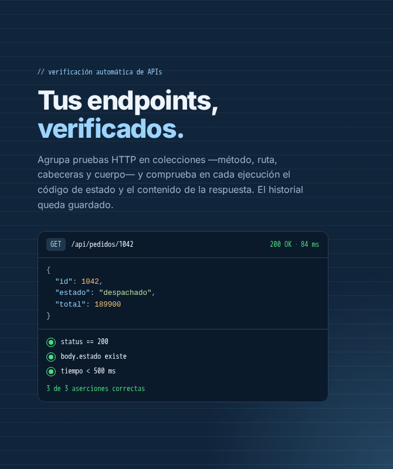

| | |
|---|---|
| **Producto** | Verificador de APIs |
| **Documento** | Manual de usuario |
| **Versión** | 2.0 · noviembre de 2026 |
| **Dirigido a** | Analistas de pruebas, desarrolladores y equipos de soporte |
| **Dirección** | [Verificador de APIs](https://eofvlnitsiuodup4eywdcenxwu0adgbz.lambda-url.us-east-1.on.aws/) |
| **Autor** | Luis F. A. |

## Contenido

1. [Portada](#1-portada)
2. [Introducción](#2-introducción)
3. [Objetivo](#3-objetivo)
4. [Alcance](#4-alcance)
5. [Acceso al sistema](#5-acceso-al-sistema)
6. [Pantalla principal](#6-pantalla-principal)
7. [Navegación](#7-navegación)
8. [Funcionalidades](#8-funcionalidades)
9. [Gestión de perfil](#9-gestión-de-perfil)
10. [Mensajes frecuentes](#10-mensajes-frecuentes)
11. [Preguntas frecuentes](#11-preguntas-frecuentes)
12. [Glosario](#12-glosario)

---

## 2. Introducción

El **Verificador de APIs** comprueba que un servicio web responda como se espera. Las pruebas se
agrupan en colecciones: cada prueba define una petición (método, ruta, encabezados y cuerpo) y lo
que debe responder el servicio. Al ejecutar la colección, la plataforma compara la respuesta real
con la esperada, mide el tiempo y guarda el resultado en el historial.

Este manual explica cada pantalla, paso a paso y con imágenes.

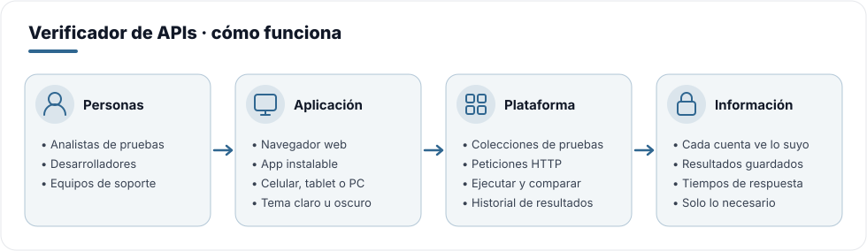

## 3. Objetivo

Que cualquier persona pueda, sin escribir código:

- Crear su cuenta e ingresar de forma segura.
- Definir colecciones de pruebas sobre un servicio web.
- Ejecutarlas con un clic y ver qué pasó, qué falló y cuánto tardó cada petición.
- Consultar el historial de ejecuciones.

## 4. Alcance

**Incluye:** registro e ingreso con verificación en dos pasos, colecciones, pruebas con método,
ruta, encabezados, cuerpo, código de estado esperado y texto esperado en la respuesta, ejecución de
la colección completa e historial con tiempos.

**No incluye:** pruebas de carga, ejecuciones programadas ni pruebas sobre servicios que no sean
accesibles desde internet.

**Qué necesitas:** un navegador actualizado, conexión a internet, un correo propio y una app
autenticadora en el celular (o acceso a tu correo para recibir códigos).

**Buenas prácticas:** prueba servicios propios o públicos de demostración. No guardes en los
encabezados ni en el cuerpo contraseñas, llaves de acceso ni datos personales reales.

## 5. Acceso al sistema

### 5.1 Crear una cuenta

En la pantalla de ingreso pulsa **Crear una**.

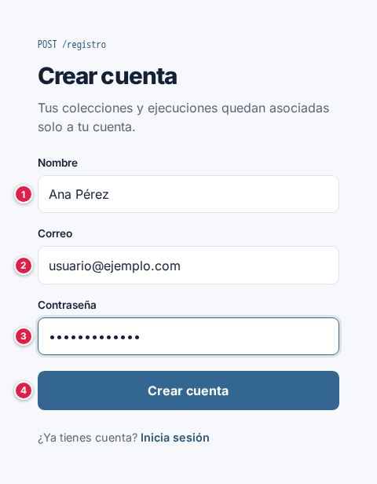

| # | Campo | Qué escribir |
|:-:|---|---|
| 1 | Nombre | Tu nombre |
| 2 | Correo | Un correo al que tengas acceso |
| 3 | Contraseña | Mínimo 8 caracteres |
| 4 | Crear cuenta | Crea tu cuenta y te lleva a configurar la verificación en dos pasos |

### 5.2 Iniciar sesión

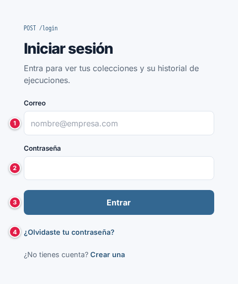

| # | Elemento | Qué hace |
|:-:|---|---|
| 1 | Correo | El correo de tu cuenta |
| 2 | Contraseña | Tu contraseña |
| 3 | Entrar | Comprueba tus datos y pasa a la verificación en dos pasos |
| 4 | ¿Olvidaste tu contraseña? | Abre la recuperación de contraseña (5.4) |

Debajo, **Crear una** abre el registro (5.1).

### 5.3 Verificación en dos pasos

Cada ingreso pide, además de la contraseña, un código de 6 dígitos. La primera vez eliges cómo
recibirlo: con una **app autenticadora** (escaneas un código QR y la app muestra un código nuevo
cada 30 segundos, incluso sin internet) o con un **código por correo**.

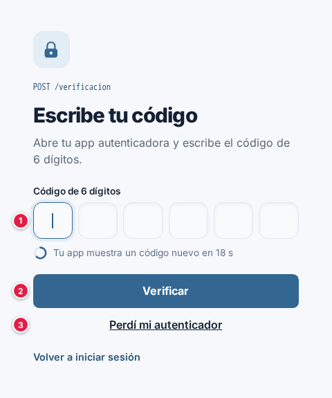

| # | Elemento | Qué hace |
|:-:|---|---|
| 1 | Código de 6 dígitos | El código que muestra tu app o que llegó a tu correo |
| 2 | Verificar | Confirma el código y abre la plataforma |
| 3 | Perdí mi autenticador | Si ya no tienes la app, te envía un código al correo de tu cuenta para configurar una app nueva |

**Perdí mi autenticador:** pulsa el enlace, escribe el código que llega a tu correo y escanea el
nuevo código QR con tu app. La app anterior deja de servir en ese momento.

### 5.4 Recuperar la contraseña

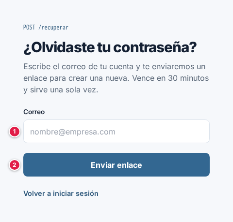

| # | Elemento | Qué hace |
|:-:|---|---|
| 1 | Correo | El correo de tu cuenta |
| 2 | Enviar enlace | Envía a ese correo un enlace para crear una contraseña nueva |

El mensaje es el mismo exista o no la cuenta. Abre el enlace del correo (vence en poco tiempo y
sirve una sola vez), escribe la contraseña nueva y vuelve a ingresar.

## 6. Pantalla principal

Al ingresar se abre **Mis colecciones**.

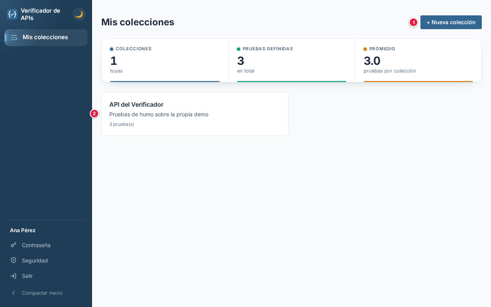

| # | Elemento | Qué hace |
|:-:|---|---|
| 1 | + Nueva colección | Abre el formulario para crear una colección (8.1) |
| 2 | Tarjeta de colección | Nombre, descripción y número de pruebas; al pulsarla se abre la colección |

Arriba, tres cifras resumen tu trabajo: cuántas colecciones tienes, cuántas pruebas definiste y el
promedio de pruebas por colección.

## 7. Navegación

En el computador el menú está a la izquierda: **Mis colecciones** y, al pie, **Contraseña**,
**Seguridad** y **Salir**. **Compactar menú** lo reduce a íconos y, al pasar el cursor, muestra el
nombre de cada opción.

| Menú compacto (computador) | Celular con la hoja "Más" |
|:-:|:-:|
| 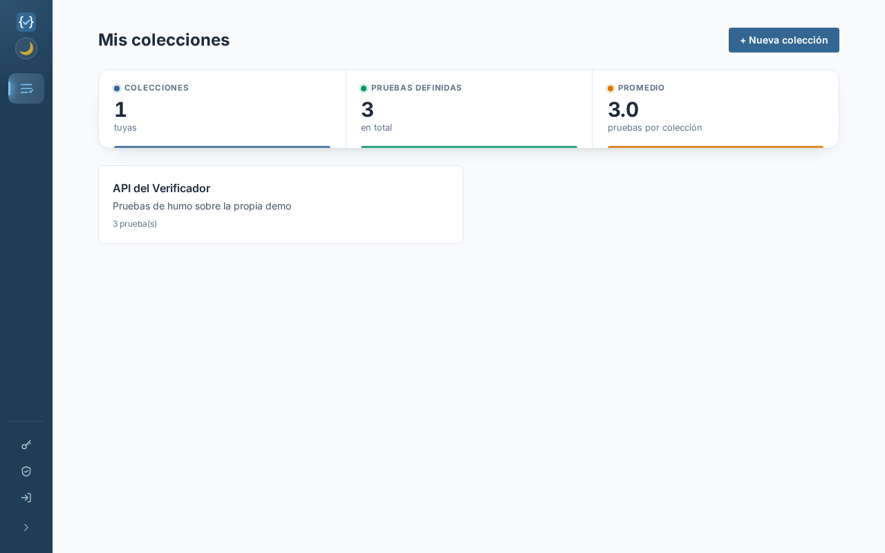 | 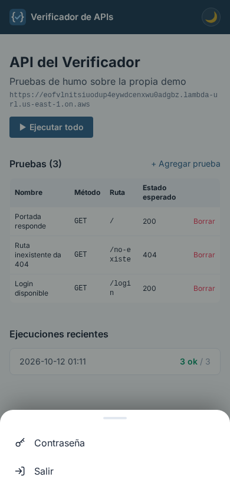 |

En el celular y la tablet en vertical, el menú pasa a una barra inferior; **Más** abre una hoja con
las opciones de la cuenta. El botón 🌙 / ☀️ cambia entre tema claro y oscuro.

## 8. Funcionalidades

### 8.1 Crear: colecciones y pruebas

**Colección.** En Mis colecciones pulsa **+ Nueva colección**.

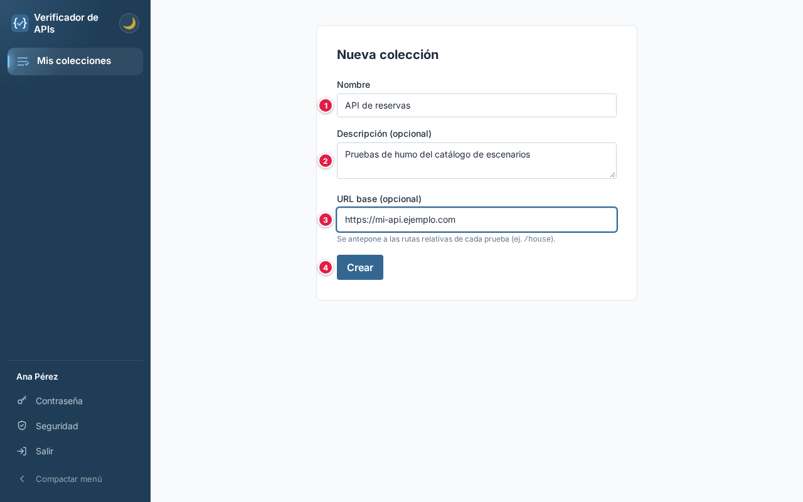

| # | Campo | Qué escribir |
|:-:|---|---|
| 1 | Nombre | El nombre de la colección |
| 2 | Descripción | Qué servicio se prueba y para qué |
| 3 | URL base | La dirección del servicio; las rutas de las pruebas se suman a ella |
| 4 | Crear | Crea la colección |

**Prueba.** Dentro de la colección pulsa **+ Agregar prueba**.

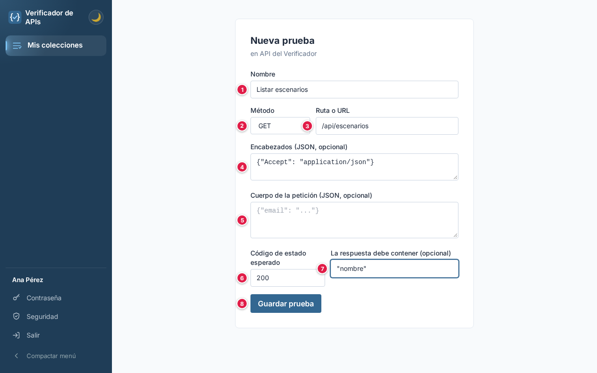

| # | Campo | Qué escribir |
|:-:|---|---|
| 1 | Nombre | Qué verifica la prueba |
| 2 | Método | GET, POST, PUT, PATCH o DELETE |
| 3 | Ruta o URL | La ruta dentro del servicio (por ejemplo `/api/escenarios`) o una dirección completa |
| 4 | Encabezados | Opcional, en formato JSON |
| 5 | Cuerpo de la petición | Opcional, en formato JSON (para POST, PUT o PATCH) |
| 6 | Código de estado esperado | El código que debe responder el servicio (por ejemplo 200 o 404) |
| 7 | La respuesta debe contener | Opcional: un texto que debe aparecer en la respuesta |
| 8 | Guardar prueba | Agrega la prueba a la colección |

### 8.2 Consultar: la colección y su historial

Al abrir una colección ves sus pruebas y las ejecuciones recientes.

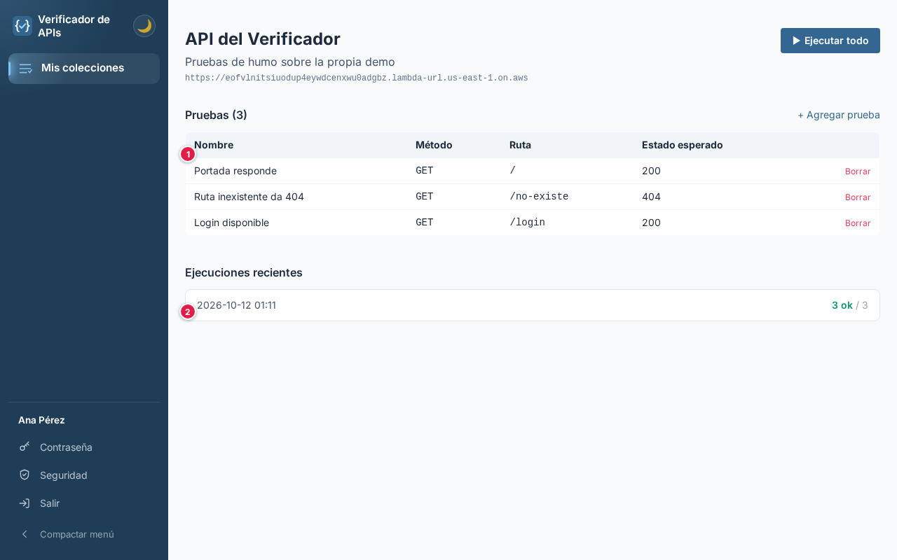

| # | Elemento | Qué muestra |
|:-:|---|---|
| 1 | Pruebas | Nombre, método, ruta y estado esperado de cada prueba |
| 2 | Ejecuciones recientes | Fecha de cada ejecución y cuántas pruebas pasaron; al pulsarla se abre su reporte (8.4) |

### 8.3 Modificar: agregar, borrar y volver a ejecutar

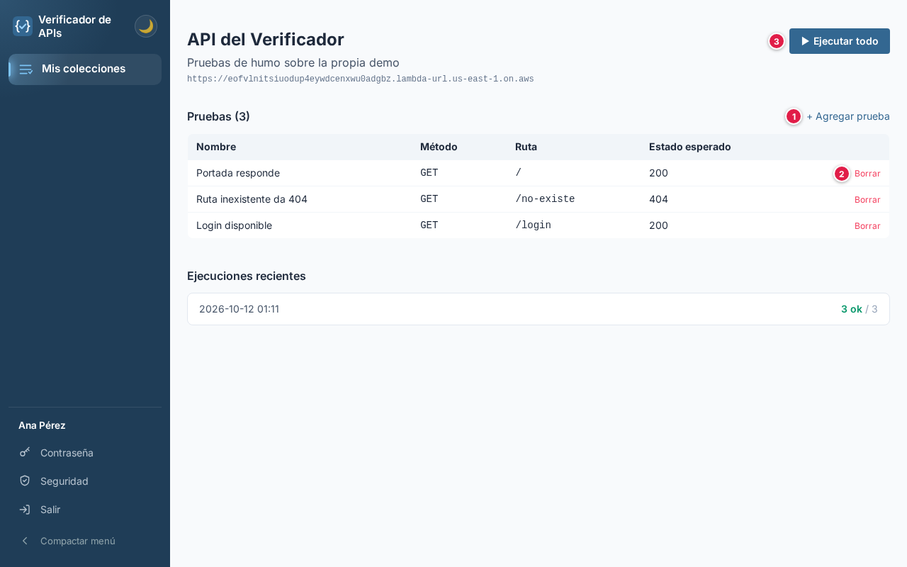

| # | Elemento | Qué hace |
|:-:|---|---|
| 1 | + Agregar prueba | Suma una prueba nueva a la colección |
| 2 | Borrar | Quita esa prueba de la colección |
| 3 | ▶ Ejecutar todo | Corre todas las pruebas de la colección y guarda una ejecución nueva en el historial |

Para cambiar una prueba, bórrala y agrégala de nuevo con los datos correctos.

### 8.4 Reportar: resultado de una ejecución

Al abrir una ejecución ves su reporte completo.

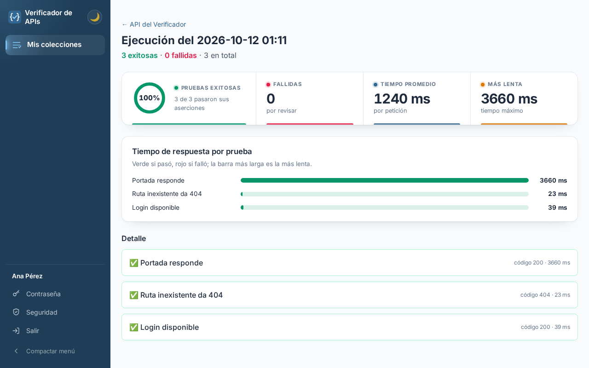

| Bloque | Qué muestra |
|---|---|
| Pruebas exitosas | Porcentaje y número de pruebas que cumplieron todo lo esperado |
| Fallidas | Pruebas por revisar |
| Tiempo promedio / Más lenta | Cuánto tardaron las peticiones |
| Tiempo de respuesta por prueba | Una barra por prueba: verde si pasó, roja si falló; la más larga es la más lenta |
| Detalle | Cada prueba con su resultado, el código obtenido y el tiempo |

## 9. Gestión de perfil

### 9.1 Cambiar contraseña

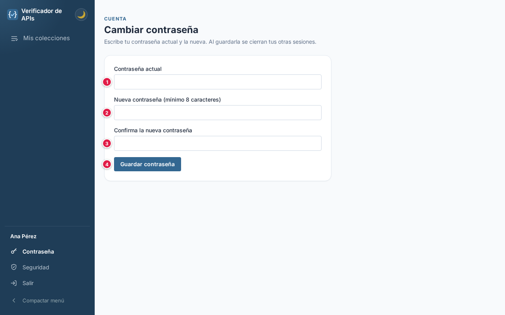

| # | Campo | Qué escribir |
|:-:|---|---|
| 1 | Contraseña actual | Tu contraseña de hoy |
| 2 | Nueva contraseña | Mínimo 8 caracteres |
| 3 | Confirma la nueva contraseña | La misma contraseña nueva |
| 4 | Guardar contraseña | Guarda el cambio; se cierran tus otras sesiones |

### 9.2 Seguridad

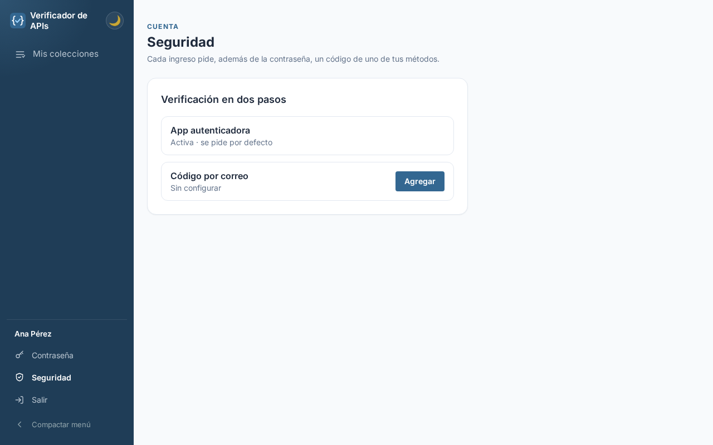

| Método | Qué puedes hacer |
|---|---|
| App autenticadora | Ver si está activa y si es el método que se pide por defecto |
| Código por correo | **Agregar** el método que te falta o **Pedir este por defecto** |

Tener los dos métodos activos te permite entrar aunque no tengas el celular a mano.

## 10. Mensajes frecuentes

| Mensaje | Qué significa | Qué hacer |
|---|---|---|
| Correo o contraseña incorrectos | Los datos no coinciden | Revísalos o usa **¿Olvidaste tu contraseña?** |
| Ese correo ya está registrado | Ya existe una cuenta con ese correo | Ingresa con él o recupera la contraseña |
| El código no es correcto o ya venció. | El código escrito no es el vigente | Escribe el código que muestra ahora la app |
| Pediste varios códigos seguidos. Espera unos minutos. | Se pidieron muchos códigos en poco tiempo | Espera unos minutos y vuelve a pedirlo |
| Tu contraseña quedó actualizada. Se cerraron tus otras sesiones. | El cambio quedó guardado | Usa la contraseña nueva en tus otros equipos |
| Esta cuenta está suspendida | La cuenta no está habilitada | Escribe a soporte (ver 11) |
| Página no encontrada | La dirección que abriste no existe | Vuelve con el menú |
| Sin conexión | Tu equipo no tiene internet | La pantalla reintenta sola |

| Página no encontrada | Sin conexión |
|:-:|:-:|
| 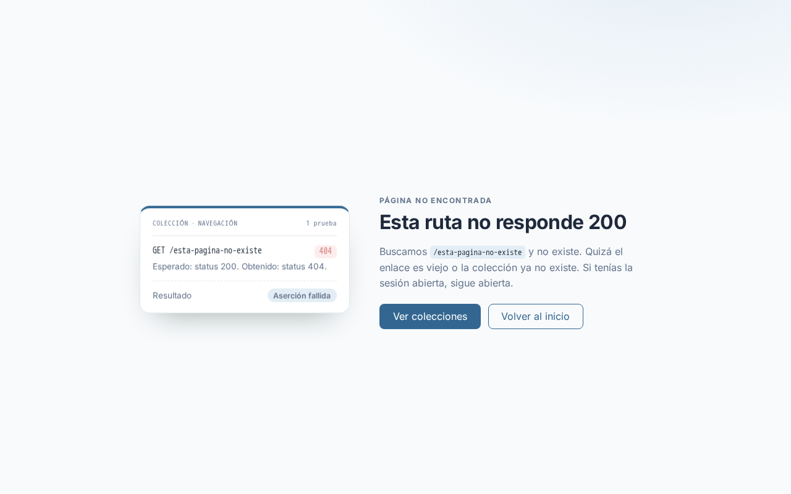 | 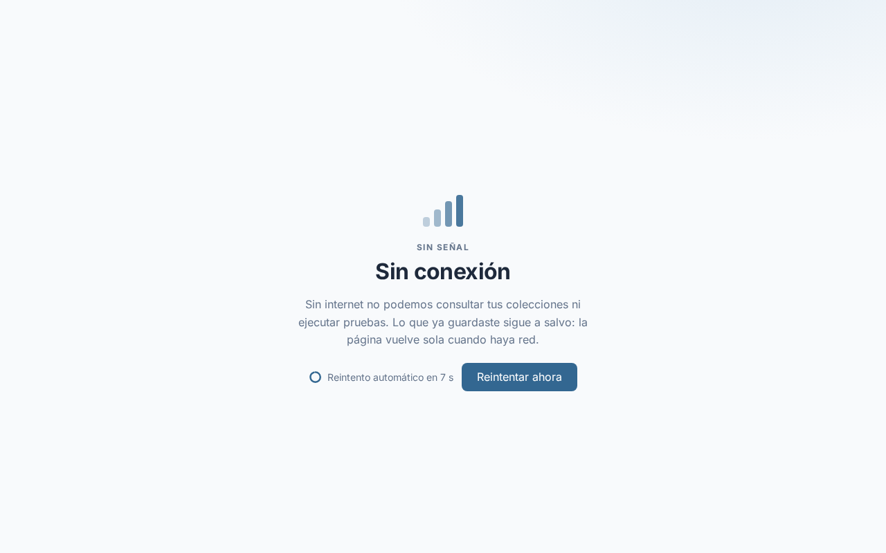 |

## 11. Preguntas frecuentes

**¿Por qué una prueba falla si el servicio funciona?** Revisa el código de estado esperado y el
texto que debe contener la respuesta: deben coincidir exactamente con lo que devuelve el servicio.

**¿Por qué la primera ejecución tarda más?** Si el servicio probado se suspende sin uso, la primera
petición lo reactiva; las siguientes son más rápidas.

**¿Otra persona puede ver mis colecciones?** No. Cada cuenta ve las suyas.

**¿Se puede instalar como aplicación?** Sí: en Chrome o Edge, **Instalar aplicación**; en iPhone,
Safari → **Compartir → Agregar a inicio**.

**¿Dónde pido ayuda o reporto un problema?** Telegram [@lfac6](https://t.me/lfac6), WhatsApp
[@carraian160](https://wa.me/carraian160) o [ariascluisf@hotmail.com](mailto:ariascluisf@hotmail.com).

## 12. Glosario

| Término | Qué significa |
|---|---|
| **API** | Servicio al que otros programas le piden o le envían datos |
| **App autenticadora** | Aplicación del celular que muestra un código nuevo cada 30 segundos para confirmar que eres tú |
| **Código de estado** | Número con el que el servicio indica cómo le fue a la petición (200 = correcto, 404 = no existe) |
| **Colección** | Un grupo de pruebas sobre el mismo servicio |
| **Cuerpo de la petición** | Los datos que se envían al servicio, por ejemplo en una creación |
| **Encabezados** | Información adicional que acompaña a la petición |
| **Ejecución** | Cada vez que se corren todas las pruebas de una colección |
| **Método** | El tipo de petición: GET consulta, POST crea, PUT/PATCH actualiza, DELETE borra |
| **Verificación en dos pasos** | Además de la contraseña, se pide un código que solo tú puedes recibir |
